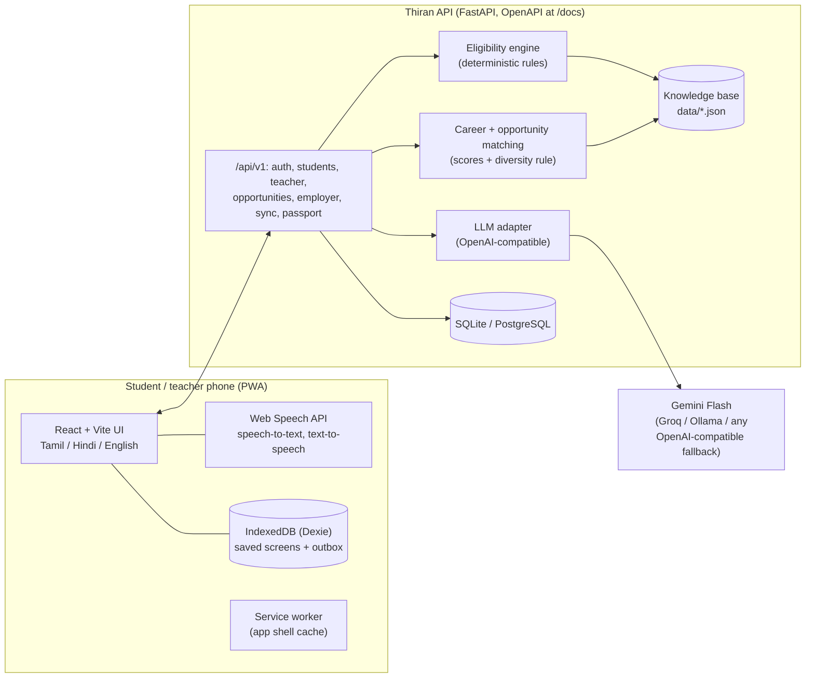

# Thiran (திறன்): a voice-first career companion for rural India

> *Thiran* is Tamil for "skill, ability".
> Citi India Hackathon 2026: **Reimagining Education & Economic Empowerment for Rural India**.
> Team **GookCode**, Shiv Nadar University Chennai.

Thiran helps a rural student (Class 9 to graduation) **discover** what they are good at by simply talking in their own language, **learn** through a step-by-step pathway built from real free courses and exams, and reach **opportunities**: scholarships, government schemes, apprenticeships and mentors. Their progress becomes a **Talent Passport** that teachers endorse and employers can trust.

Teachers use **facilitator mode** to guide a whole class from one phone. Employers, CSR teams and NGOs post opportunities, search endorsed talent and track impact, and they are the ones who pay.

**In one line:** LinkedIn plus a career counsellor, by voice, for rural India.

---

## What it does

| | Feature | How |
|---|---|---|
| 🎙️ | **Discover** by voice or text in Tamil, Hindi or English | A guided AI interview (Gemini) turns a natural conversation into a structured profile: interests, work style, marks, family situation and goals. Tappable answers make it usable for low-literacy students. |
| 🧭 | **Career matching across many fields** | 69 careers in 8 fields (skilled trades, healthcare, agriculture, creative, government, services, STEM, own business). A diversity rule means suggestions always span at least 4 fields, not just "doctor or engineer". |
| 🪜 | **Personal pathway** | Steps are built **only** from the catalogue (72 free courses on SWAYAM, DIKSHA, Skill India Digital, NPTEL and Naan Mudhalvan, plus 38 exams). The AI only translates and adds personal tips, so it can't invent a course. |
| 🎁 | **Scholarships and schemes with "why you qualify"** | A **deterministic eligibility engine** checks 24 scholarships and 17 schemes against each record's rules. The AI never decides eligibility; it only explains the result in the student's language. |
| 🛠️ | **Apprenticeships, jobs and mentors** | Opportunities are ranked by fit with the student's goal, interests and district. Mentors are matched by career. |
| 🪪 | **Talent Passport** | Badges for completed steps, applications and modules, plus **teacher endorsements**. Each passport has a QR code and a public link that shows the first name only and no contact details. |
| 👩‍🏫 | **Facilitator mode** | Class roster, AI insights for the week, endorse a skill, recommend a student for an opportunity, add students who have no phone and use Thiran *for* them on the teacher's phone. |
| 💸 | **Teacher module marketplace** | Teachers publish lessons as free, pay-per-module or subscription. There is a 10% platform fee, and CSR sponsors can make a module free. |
| 🏢 | **Employer / CSR / NGO** | Post listings (a schema.org JobPosting-like API), get matched candidates, search endorsed talent (paid unlocks or the Talent Pro plan), contact students only through their teacher, and see a CSR impact dashboard. |
| 📴 | **Offline-first** | An installable PWA. The app shell is cached by a service worker, screens are saved in IndexedDB (Dexie), and actions taken offline go into an outbox that syncs with idempotent ops when the phone reconnects. Discover switches to a scripted interview offline. |
| 🧑‍🏫 | **First-visit guided tour** | The login, student, teacher and employer screens each walk new users through the key areas with a spotlight, and Next, Back and Skip buttons. Tap **?** to replay it. The app opens in English, and the 🌐 picker switches to Tamil or Hindi at any time. |
| 🔊 | **Voice in and out** | Uses the browser's free speech APIs (ta-IN, hi-IN, en-IN on Android Chrome). Every answer can be read aloud. |

## Architecture



**How the AI is used.** Facts always come from the knowledge base, and the model is used for understanding, explaining and translating.

1. **Profiling**: the interview model returns structured JSON, which is validated against allowed values before it is saved.
2. **Career matching**: explainable scores plus a diversity rule. The model writes the "why this suits you" line.
3. **Eligibility**: rules only. Conditions the engine can't check (for example "cleared the NMMS exam") are shown as "only if", never as "you qualify".
4. **Pathways**: steps come from the catalogue. The model translates them and adds tips.
5. **Teacher insights**: the counts are computed from data, and the model writes a short weekly action summary.

Every AI call has a rule-based fallback, so the app keeps working when the model is rate-limited or the phone is offline. Providers are tried in order (`LLM_PROVIDERS=gemini,groq,ollama`), so the stack can run fully self-hosted with Ollama.

## Run it

You need Python 3.11 and Node 20+.

```bash
# 1. Python environment (the team uses pyenv)
pyenv virtualenv 3.11.16 thiran-gookcode && pyenv local thiran-gookcode
pip install -r requirements.txt

# 2. Settings: add a free Gemini key from https://aistudio.google.com (optional: Groq key as fallback)
cp .env.example .env

# 3. Build the web app and start the server
./run.sh
```

Open http://localhost:8000. The API docs are at http://localhost:8000/docs.

Or use Docker: `docker compose up --build`.

For frontend development with hot reload, run `cd frontend && npm run dev`. That serves the app on :5173 and proxies the API to :8000.

Reset the demo data with `python -m backend.app.seed --reset`, and run the tests with `python -m pytest backend/tests`.

### Demo accounts (PIN 1234)

| Phone | Who | Try |
|---|---|---|
| 9000000001 | **Meena S**, Class 11, profile done | Careers, pathway, scholarships, passport |
| 9000000006 | **Kavya R**, new student | Discover by voice from scratch |
| 9000000002 | **Raju K**, government school teacher | Class insights, endorse, recommend, "Use Thiran for Priya" |
| 9000000003 | **MedLab Diagnostics, Madurai** (employer) | Applicants, talent search, unlock passport |
| 9000000004 | **Vidiyal Foundation** (CSR / NGO) | Impact dashboard, sponsored listings |

The 3-minute walkthrough for judges is in [docs/demo-script.md](docs/demo-script.md).

## Extend it

- **Add a language:** add `frontend/public/locales/<code>.json` (drafted with `python tools/translate_locales.py <code>`), add labels in `data/interview.json`, and add the code to `LANGUAGES` in `backend/app/config.py`.
- **Add a scheme, scholarship, course, exam or career:** edit the JSON in `data/` (see [data/SCHEMA.md](data/SCHEMA.md)). This needs no code change. Every record carries `source_url` and `last_verified`.
- **Swap the AI provider:** change `LLM_PROVIDERS` and the matching key in `.env`. Any OpenAI-compatible endpoint works.
- **Swap the speech engine:** `frontend/src/lib/voice.js` is the only place speech is used, so BHASHINI or Sarvam can replace the browser voices there.

## API for partners

Everything is under `/api/v1` and documented with OpenAPI at `/docs`.

| Endpoint | For |
|---|---|
| `GET /opportunities`, `POST /opportunities` | Colleges, employers and NGOs list or push apprenticeships, internships and jobs |
| `GET /kb/{careers,courses,exams,scholarships,schemes}` | Open data: the curated knowledge base |
| `GET /passport/{slug}`, `/passport/{slug}/qr.svg` | Verify a student's Talent Passport |
| `GET /employer/impact` | Aggregated, anonymous outcomes for CSR reporting |
| `POST /sync` | Batch upload of offline actions (idempotent `op_id`) |

## Business model

Students never pay. Revenue comes from the demand side:

- **Talent search for employers:** 3 free passport unlocks, then ₹99 each, or **Talent Pro at ₹2,999 a month** for unlimited unlocks.
- **Sponsored listings and scholarships** for CSR teams and NGOs, with an **impact dashboard** for Schedule VII reporting.
- **Teacher module marketplace** with a 10% platform fee.
- **Licences for state skill missions and colleges** (dashboards and API integration).

Payments are simulated in the prototype. Production would use UPI.

## Privacy and safety

- Students log in with a phone number and PIN. There is no Aadhaar, and the PIN is stored as a PBKDF2 hash.
- Role-based access: a teacher can act only for students on their own roster.
- Organisations only ever see a student's **first name and last initial**. Contact goes through the teacher, who accepts or declines.
- Free-tier AI may use prompts for training, so production should use a paid tier or a self-hosted model (Ollama) for student data.

## Project structure

```
backend/app/        FastAPI app: api/ (routers), ai/ (llm, profiler, careers, eligibility, pathways, matching)
backend/tests/      end-to-end API tests (run without the AI)
data/               knowledge base JSON + SCHEMA.md + interview.json
frontend/           React + Vite PWA: src/views, src/lib (api, offline store, voice, i18n), public/locales
tools/              string extraction and locale drafting
docs/               demo script
```

## Data sources

The knowledge base was curated in October 2026 from National Scholarship Portal, SWAYAM, NPTEL, DIKSHA, Skill India Digital, NAPS (apprenticeshipindia.gov.in), NATS, NTA, TNPSC, SSC, RRB, AICTE, Naan Mudhalvan, TNSDC and Tamil Nadu department portals. Amounts and dates change often. Records marked "verify on portal" should be checked before real use. Apprenticeship listings and employer names are **demo data**.

## Team GookCode

Shiv Nadar University Chennai: Akhshan P, Sarvesh Adithya J (lead), S Akshaya, Prahanya Selvakumar, Rithu Varshini V K.

MIT licensed.
